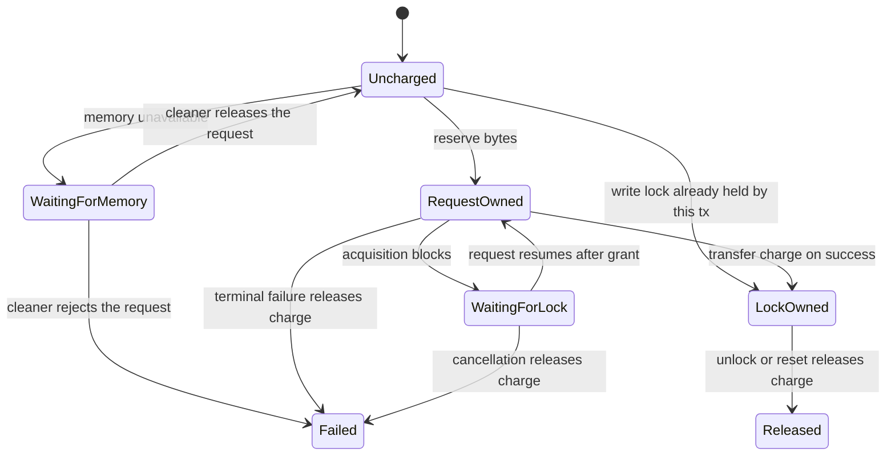

# Reserve payload memory before acquiring write locks

Status: designed 2026-10-29, rewritten 2026-10-30 after review, implemented
2026-10-30 on the data substrate branch that carries this document. The
stable rules now live in `docs/03-concurrency-control.md`,
`docs/04-transaction-execution.md` and `docs/07-durability-and-recovery.md`;
this document remains as change context. Where it and the code differ, the
code and those documents are authoritative.

Baseline: `eloqdata/tx_service` main as of
[PR #577](https://github.com/eloqdata/tx_service/pull/577).
Related work: [PR #576](https://github.com/eloqdata/tx_service/pull/576), as
reviewed on 2026-10-29.

This is a proposal for implementing the agreed reservation ownership model on
current main. It is not a description of behavior already present in the numbered
architecture documents. Names for new helpers below describe their contracts;
their final spelling can follow the surrounding implementation.

## 1. Decision

Charge the destination shard's payload reservation **before attempting write-lock
acquisition**, and treat reserved bytes as used memory in every memory decision
the shard makes. The acquire request owns that charge until acquisition succeeds
or terminates:

- On success, transfer the charge to the granted write lock. The shard total does
  not change during this transfer.
- If the transaction already holds the write lock on the entry, take no charge.
  The lock keeps the charge it received when it was granted, and the request
  reports success without a transfer. A write intent held by the transaction
  does not count: the upgrade to a write lock is charged like a fresh attempt.
- On terminal acquisition failure, return the charge to the shard heap. A failed
  lock attempt leaves the transaction's original read lock or intent under the
  existing cleanup rules.
- While acquisition is blocked on another lock, retain the charge on the pending
  request. Blocking is not terminal failure.
- When the write lock is released or reset, subtract its reservation through one
  shared helper in `NonBlockingLock`. The helper does nothing else.

A reservation that does not fit is a memory failure like any other. The request
parks on the shard's existing memory wait list, and the existing cleaner releases
it when the heap, counting reservations, has room again. There is no separate
list, no separate wake-up, and no distinction between "reserved but not yet
installed" and "allocated".

Parked requests of every kind are rejected with `OUT_OF_MEMORY` under the same
rules. At the end of a pass that still has requests parked, the cleaner rejects
requests that opted in through a range read lock, as today, and requests that
have stayed parked across `K` concluded checkpoint cycles, with `K` defaulting
to 5. A cycle is one run of the checkpointer over every node group on the node,
and it concludes when each group's part has flushed, found nothing to flush,
been unable to advance because a write lock pins the timestamp, or failed.
Otherwise the cleaner defers as today. Whether the heap is at its limit does not enter
into it; a request can fail to fit below the limit. A payload larger than the
entire configured shard budget is rejected immediately.

Allocator statistics and record size estimates remain approximate. This is a soft
admission limit used with deployment headroom. It does not attempt to establish a
hard RSS or peak-allocation guarantee.

## 2. Problem and scope

Record transactions currently acquire write locks, write their WAL record, and
then install payloads in `PostWrite`. Admission checks allocated shard memory, but
does not account for payloads promised by acquisitions that have not reached
installation. Multiple admitted writes can therefore consume the same apparent
free capacity.

Two kinds of requests wait for shard memory. This document names them:

- **Installations** need physical memory now: cache fills on a read miss, upload
  batches, and the entry an acquisition itself may have to create. Today they
  park on the shard memory wait list and depend on eviction.
- **Acquisitions** are write-lock requests at commit. They need a promise of
  memory for a value that `PostWrite` installs later, after the WAL record.

Both wait on the same list, are admitted by the same check, and are rejected by
the same rules. The distinction matters only for describing what each needs.

The reservation covers buffered record writes through `AcquireCc`, including
primary, secondary, unique-secondary, and forwarded destinations. This document
uses the source name `AcquireCc` for the request discussed as `AcquireWriteCc`.

The estimate is the source record's `MemUsage()` at commit-time acquisition:

```cpp
requested_bytes =
    write_entry.op_ != OperationType::Delete && write_entry.rec_ != nullptr
        ? write_entry.rec_->MemUsage()
        : 0;
```

Every destination that will install its own copy receives the full estimate.
Deletes reserve zero payload bytes even if a record pointer happens to remain in
the write set. The write set must remain stable from acquisition through logging
and post-processing, as required by the existing commit protocol.

The estimate does not credit the existing value's eventual replacement. That value
may coexist with the new allocation or remain as an MVCC version. Key, page, and
entry allocations continue to appear in allocator usage and use existing entry
admission checks. Object-command execution and metadata acquire-all operations do
not gain a new payload estimator in this change; callers without a record payload
pass zero.

## 3. Accounting and ownership

Each `CcShardHeap` has one aggregate counter, `reserved_bytes_`. Each granted write
lock has one `reserved_bytes_` value. A pending acquire request stores its requested
budget and whether it currently owns the corresponding charge.

The invariant on each shard is:

```text
heap.reserved_bytes =
    sum(charges owned by pending acquire requests)
  + sum(charges owned by granted locks)
```

A request parked for memory has no charge for this key. The transaction may still
own reservations on other keys or shards. A request parked for a lock already has
its charge. A request that finds its own transaction's write lock on the entry
never charges: the lock already owns the bytes. There is no additional shard
ledger, transaction-wide reservation map, or registration of pending reservations
in the lock registry.

| Transition | Request-owned bytes | Lock-owned bytes | Heap total change |
|---|---:|---:|---:|
| Memory unavailable; park | 0 | 0 | 0 |
| Reserve `B` bytes | `B` | 0 | `+B` |
| Write lock already held by this transaction | 0 | `B` (unchanged) | 0 |
| Lock conflict queues the request | `B` | 0 | 0 |
| Lock acquisition succeeds; transfer | 0 | `B` | 0 |
| Pending acquisition fails or is canceled | 0 | 0 | `-B` |
| Granted lock is released or reset | 0 | 0 | `-B` |

The table describes the new charge for this acquisition. Other owners' charges and
any previously granted lock remain independently accounted.



The existing queue grants a lock before re-enqueuing its request. During the short
grant-to-resume interval, the request still owns the charge. This is safe: the heap
has already been charged and the request remains alive. Transferring ownership in
`Execute(AcquireCc&)` needs no change to the lock-grant algorithm.

All reservation changes occur in the owning shard's execution context. The shard
execution boundary already serializes them. A plain counter is sufficient under
that contract; diagnostics must read it through shard work or an explicitly
synchronized snapshot. No new mutex or cross-shard atomic reservation transaction
is needed.

## 4. Heap interface

A reservation is used memory. `CcShardHeap::Full()`, and every decision that
reads it, counts allocated plus reserved bytes against the limit. For sampled
allocated usage `A`, outstanding reservations `R`, requested bytes `B`, and limit
`L`, a positive reservation is admitted when:

```text
A + R + B <= L
```

Entry admission for every request kind uses the same number. Under reservation
pressure, installations park even though physical memory is free, until a
transaction aborts, an installed value turns out smaller than its estimate, or
the cleaner evicts.

Add the following operations to `CcShardHeap`:

| Operation | Contract |
|---|---|
| `TryReserve(bytes)` | Check `A + R + bytes <= L` and increment the counter on success; leave it unchanged on failure. |
| `ReleaseReservation(bytes)` | Subtract a charge previously acquired on this heap. |
| `ReservedBytes()` | Read the counter under its shard ownership contract. |
| `PhysicalAllocated()` | The allocator's allocated figure alone, for the cleaner's productivity measure and for diagnostics. |

Use checked/subtractive arithmetic to avoid overflow. A successful zero-byte
reservation does not change the ledger and does not bypass entry admission.
Preserve the existing defragmentation constraint (committed memory over the
limit) as an additional capacity condition. Invalid allocator statistics must
not be mistaken for zero usage. Counter underflow is an accounting error, not a
reason to wrap or silently reset the ledger.

A non-zero reservation also starts defragmentation when the heap is fragmented,
whether it is admitted or refused. Entry admission in `FindEmplace()` used to
be the only place that started it, and an acquisition on an existing key no
longer runs entry admission. Without the check at the reservation, a heap that
is full only because committed memory is over the limit would park such
acquisitions with nothing to bring the committed memory down. The reservation
has just read the allocator's figures for its own capacity check, so the
defragmentation check reads nothing more.

Keep one output physical: the bytes a cleaner pass reclaimed are measured from
the allocator's allocated figure, so a reservation returned mid-pass is not
counted as evicted memory.

Allocator statistics are read as they are today; nothing is refreshed per
request. After installation and reservation release, the allocated figure may
briefly lag the actual allocations; this approximation is accepted.

## 5. Acquire request state and execution

### 5.1 Request state

`AcquireCc` carries:

- `requested_bytes_`, fixed for the attempt;
- the bytes it currently owns and the heap charged for them;
- an ownership/phase indicator sufficient to distinguish an uncharged attempt,
  request ownership, and ownership already transferred to a lock.

These can be represented by a small token or direct fields. They must survive
asynchronous waits. A stack-only rollback guard cannot own the reservation across
`Execute()` returning pending. The ownership indicator also prevents zero-byte
requests and post-grant retries from being confused with a fresh attempt.

Provide request operations to acquire the charge, release it on failure, and
transfer it to a lock. Taking a charge clears its previous owner first. Transfer
does not decrement and re-increment the heap counter.

The existing `AbortIfOom()` and the log replay exemption of §8 become one call,
`CcRequestBase::MemoryWaitPolicy()`, which returns how long a request may wait
for memory (`MemoryWait`). `kFailFast` covers the requests for which
`AbortIfOom()` was true: a transaction's requests while it holds a range read
lock, and slice scans, slice fills and upload batches always, since their wait
could block a range split. `kUnbounded` is for the requests that must be
applied: log replay, and a write forwarded to a standby, whose abort hook puts
it back on its shard's queue instead of ending it. Everything else is
`kBounded`. The rejection rules of §8 read it for every parked request.

### 5.2 Fresh attempt

The order in `TemplateCcMap::Execute(AcquireCc&)` is:

1. Perform the existing leadership, schema, and request validation.
2. Locate or create the target entry using normal entry admission. If entry
   admission fails, park on the memory wait list without acquiring this payload
   reservation, as the request does today.
3. If the entry's lock is already a write lock held by this transaction, take no
   charge. Mark the request's charge as lock-owned and go straight to result
   construction. A write intent held by this transaction does not count; that
   upgrade continues with the next step.
4. Before calling the lock-acquisition operation, try to charge the requested
   payload bytes.
5. If the reservation does not fit, park on the memory wait list without
   attempting or upgrading the write lock. If the request can never fit within
   the configured limit, complete with OOM instead.
6. Attempt the existing lock acquisition with the request owning the charge.
7. On immediate conflict/error, release the request's charge and report the
   existing error. On blocking, retain it and return pending. On success,
   transfer it to the write lock before reporting success.

Locating the entry before charging avoids having a new request's own payload
reservation cause its entry-admission check to reject itself. Entry creation and
reservation happen in the same shard execution step.

The tables that entry admission exempts from the shard memory limit, the meta
tables and the sequence table, are exempt at the reservation step too: their
acquisitions proceed as zero-byte reservations. Range split allocates range
ids through the sequence table and commits that transaction to free memory,
so parking its write for memory would make reclamation wait for itself.

Step 2 depends on a fix to `FindEmplace()`. Today it checks the heap before it
looks the key up, and for a write on a data table it returns "not found" on a
full heap even when the entry exists; only read-only requests get the lookup
first. Finding an existing entry allocates nothing, so capacity has no bearing
on it. Reorder the function: locate the page and look the key up; if found,
return it; otherwise check capacity, wake the cleaner if the heap is full, and
emplace or refuse. "Not found" then means exactly one thing: the key is absent
and a new entry cannot be admitted now. Without this, a re-sent acquisition
whose write lock this transaction already holds parks behind its own
reservation instead of taking step 3, and an acquisition on an existing key
parks for entry memory it does not need. The reorder is part of this change.

The callers that reserve nothing keep a capacity check on an existing key:
object commands, log replay, batch upload and standby forwarding. For them it
is not entry admission but the only brake on payload growth: returning an
existing entry to them with no further check would let writes to resident keys
grow the heap without limit. The check is theirs to make, not `FindEmplace()`'s:
after they have the entry, found or just emplaced, they call
`UnreservedWriteMustWait()`, which tests the same fullness as entry admission
with the same exemption for the meta tables and the sequence table, and they
park or fail as they do for a miss. A just-emplaced entry is checked too: entry
admission ran before the entry, and maybe a new page, were allocated. It sees
the heap only after it has filled, so it stops such writes one payload late.

Orphan lock recovery must not go through that check, and must not mistake a
full heap for a missing lock. It arrives as a `ReplayLogCc` flagged by the log
service (`IsLockRecovery()`), carrying the committed transaction's number. It
looks the key up without emplacing (`Find()`): a lock can only sit on an
existing entry. If the transaction no longer holds the key's write lock or
write intent, the record is skipped. If it does, the record is installed and
the lock released whatever the heap's state. The orphaned write lock keeps the
checkpoint below its timestamp, so a recovery parked for memory could wait on
the flush its own lock blocks; and the lock still carries the reservation its
acquisition charged, which the release returns. With the capacity check inside
`FindEmplace()`, a full heap returned "not found" for the locked entry, the
recovery read that as "lock not held" and reported completion, and the lock
and its reservation stayed, helping to keep the heap full.

Step 3 is what makes a re-sent acquisition safe. After a leadership change on one
node group, the acquire operation re-runs and re-sends every key, including keys
whose write locks this transaction still holds on healthy node groups. Without
the check, the charge-before-lock order would charge the key a second time and
the lock's fast path would then report success. With it, the shard total is
unchanged and the only charge for the key stays on the lock until release.

A memory wait before locking must not retain an unprotected raw entry pointer.
Today the request parks only when no entry could be created, so it has no pointer
to keep. Step 5 parks after the entry was found or created, and that entry can be
evicted while the request waits. Do not publish it as the saved continuation
pointer until the existing lock/queue ownership protects it; after a memory
wait, look the entry up again by key. This does not remove a read lock or intent
that the transaction already holds.

### 5.3 Resuming a blocked acquisition

The lock queue already owns the request's continuation and the request already
owns its reservation. When it resumes:

1. Apply the existing fencing and resumed-lock bookkeeping.
2. Do not try to reserve again and do not reject it because later admissions have
   filled the remaining capacity.
3. Transfer its existing charge to the granted lock.
4. Continue the normal result construction and any existing post-grant work.

The transfer occurs before any post-grant key-cache retry or final result
publication. A subsequent retry of that work must not reserve or transfer twice.
The ordinary success result retains its current meaning.

A resumed waiter can never find its own transaction already holding the write
lock, because the queue granted that lock to this very request. The held-lock
check of step 3 in the fresh attempt is therefore only an assertion here. A
request whose budget differs from the charge the lock already carries for the
same transaction is an invariant violation to investigate, rather than permission
to overwrite the stored charge. The normal buffered-record commit path fixes the
payload before acquisition.

### 5.4 Control-flow sketch

```text
ExecuteAcquire(request):
    validate request and destination

    if resuming post-grant work:
        assert reservation ownership is already resolved
        continue existing post-grant work
        return

    if resuming a lock waiter:
        assert request still owns its reservation
        assert the write lock is not already this tx's from before the wait
        run existing resumed-lock bookkeeping
        on terminal error: release request reservation and complete error
    else:
        locate or emplace entry
        if entry admission fails:
            park uncharged request on the memory wait list
            return pending

        if the entry's write lock is already held by this tx:
            mark charge as lock-owned, no charge taken
            populate ordinary acquire result
            continue existing post-grant work
            return

        if requested payload exceeds the shard limit:
            complete OOM without lock acquisition
            return completed

        if charging the payload fails:
            discard unprotected continuation pointer
            park uncharged request on the memory wait list
            return pending

        result = existing lock acquisition
        if result is blocked:
            retain request reservation
            return pending
        if result is terminal failure:
            release request reservation
            complete existing error
            return completed

    transfer request reservation to granted lock
    populate ordinary acquire result
    continue existing post-grant work
```

This is ownership pseudocode, not a replacement for the existing fencing,
timestamp, key-cache, and request-recycling code.

## 6. Terminal failure and request recycling

Centralize rollback in an acquire-request helper that releases only a charge
currently owned by that request. Call it for both normal execution errors and
`AcquireCc::AbortCcRequest()`.

Some failures occur in `TemplatedCcRequest` before map dispatch, such as a term
check on a resumed request. Those paths must invoke the same cleanup contract.
A narrow default-no-op terminal-error hook in the common request dispatcher is
one way to provide this without duplicating its dispatch logic. Acquire-specific
map errors must use the same helper before publishing their result.

Release the charge before result completion can publish the failure or send the
remote response. Do not condition release on the boolean returned by
`CcHandlerResult::SetError()`: that boolean can describe completion of the entire
fan-out result, while this individual acquire has already terminated.

Cancellation of a queued acquisition, whether by the deadlock detector's victim
abort or by a term change, is an ordinary terminal failure: it reaches
`AcquireCc::AbortCcRequest()`, which returns the charge through the same helper.
Nothing about it is specific to deadlocks. The memory wait list unlinks a request
before aborting/freeing it, as it does today.

`Free()` and `Reset()` should assert that request-owned reservation state is empty.
They are ownership checks, not the primary place to return capacity: pooled request
destruction or reuse can happen much later and in a different context. An
idempotent cleanup helper may be used defensively before publishing a request as
reusable, but must not hide missing terminal cleanup.

A coordinator timeout alone does not release a remote participant's reservation.
The participant releases it when its pending request is actually canceled or
invalidated, or transfers it to the lock if acquisition succeeds. Existing fencing
and orphan recovery resolve ownership after a lost reply. A term change between
queue grant and resumed execution must return the request-owned charge while the
existing term cleanup clears the old lock state.

## 7. Lock-owned reservation and centralized release

Add `reserved_bytes_` to `NonBlockingLock` and a shared release helper with access
to the owning shard/heap. Its operation is:

```text
bytes = take_and_zero(lock.reserved_bytes)
if bytes != 0:
    heap.ReleaseReservation(bytes)
```

The helper does not wake the cleaner and does not touch the wait list. If
requests are parked, the cleaner is already queued, mid-pass, or deferred with a
retry deadline, and its next execution reads the heap afresh. If nothing is
parked, there is nothing to release. Returned reservations are picked up the way
memory freed by any other means is picked up today. Adding a check to the lock
release path would cost every `PostWrite` to serve a rare case.

Note what a release means for capacity. After a commit, `PostWrite` has installed
the value, so the allocated figure has grown by about what the reservation
promised; returning the reservation leaves the effective total roughly where it
was. Capacity actually comes back on abort, when nothing was installed; when an
installed value is smaller than its estimate; or when the allocator frees the old
value that the new one replaced.

Use the helper from the small number of places that end a write lock:
`ReleaseWriteLock`, `ClearTx`, `DowngradeWriteLock`, and lock reset. A charge
lives only on a write lock, so a downgrade to an intent returns it. Downgrades
happen on metadata paths, whose acquire-all requests reserve nothing, so the
release there is normally a no-op; the record acquisition path keeps its write
lock until post-processing.

Normal release returns the old owner's reservation before waking/granting queued
requests. `PostWrite` continues to install the committed payload before releasing
the lock. No separate reservation subtraction is added to transaction commit or
abort code.

Bulk cleanup currently reaches the underlying lock through:

```text
LruEntry::ClearLocks()
  → KeyGapLockAndExtraData::Reset()
    → NonBlockingLock::Reset()
```

That path already clears the locks; it is not an existing uncleared-lock bug.
Extend the reset interface to carry the owning shard when clearing live state, so
it can call the same reservation-release helper before zeroing fields. A
construction/reuse reset without a shard is permitted only when the reservation
is already zero. Audit reset callers accordingly.

During bulk invalidation, cancel queued requests and return their request-owned
charges, return the lock-owned charge, and then reset/recycle the lock object.
Do not wake and grant those invalidated queued requests as a side effect of bulk
reset. No new per-transaction cleanup registry is needed.

## 8. Memory waiting, eviction, and checkpointing

### 8.1 Waiting policy

A reservation that does not fit parks the uncharged request on the existing
shard memory wait list, increments the existing park counter, and schedules the
cleaner through the normal path, exactly as a failed entry creation does today.
A released request re-executes as a fresh attempt and performs entry admission
and reservation again. If it parks again, that counts against the cleaner's
release pacing like any other re-park.

Requests waiting for locks retain their charged reservations. Requests on the
memory wait list have not attempted the write-lock upgrade. A request is on at
most one wait queue at a time.

Other keys of the transaction may already have reservations. Waiting is still
allowed: eviction, a flush, or another transaction's abort may admit the
remaining key. The situation waiting cannot resolve is a set of transactions
that hold what each other waits for, with at least one of them parked for
memory. §8.2 breaks it, for parked requests of every kind.

### 8.2 Integration with current main

Current main calls `AbortRequestsAfterMemoryFree()` at the end of a cleaner pass
when the heap remains full or the pass freed no entries. That helper only rejects
requests for which `AbortIfOom()` is true. Remaining waiters stay parked, and the
cleaner can request a checkpoint and defer another pass. Write acquisition
currently derives the flag from `HoldingRangeReadLock()`; bucket-only ownership
does not satisfy that predicate.

Retain the current cleaner's bounded scans, batches of 20 released requests,
reclaimed-byte pacing, checkpoint notifications, and deferred retry/backoff.
Adapt it to the reservation-inclusive heap rather than replacing it with the
older algorithm in PR #576.

The integration must satisfy these rules:

1. **Every heap read the cleaner makes includes reservations.** Its full check,
   its eviction target, its end-of-pass full condition, and the gate on
   releasing a batch all read allocated plus reserved bytes. With that, a failed
   reservation drives an eviction pass even when physical allocation is below the
   old watermark, and the pass evicts towards limit minus reserved bytes without
   any separate rule.
2. **Productivity stays physical.** Whether a pass reclaimed enough is measured
   from the allocator's allocated figure before and after the eviction step. A
   reservation returned mid-pass is not an evicted entry.
3. **Rejection applies to every parked request alike.** The trigger is the end of
   a pass with requests still parked. A pass ends only when it has reached the
   tail of the LRU chain and still holds requests it could not release: either
   the heap is at its limit, or nothing was reclaimed since the last release and
   the released requests parked again. Either way those requests did not fit and
   the pass has nothing more to offer them. Fullness is not a condition: a
   request larger than the free room fails to fit with the heap below the limit,
   and a rule gated on `Full()` would never reach it. At that point the cleaner
   rejects, through each request's ordinary terminal error path:
   - requests with the range-read-lock opt-in, as today;
   - requests that have stayed parked across `K` concluded checkpoint cycles
     (the **K-cycle rule**, below).
   Anything else stays parked. The cleaner then requests a checkpoint, however
   much the pass reclaimed, since eviction could not make the room those
   requests need, and defers. It skips the request when a flush or range split
   completed on the shard during the pass, because the pass then runs once more
   and decides. (The cleaner used to request one only after a pass that
   reclaimed less than `shard_clean_release_kb` over the whole sweep, which
   delayed the request by a pass whenever the sweep had evicted that much
   before the parked requests used it up.)
4. **No new scheduling.** A reservation release does not notify the cleaner. The
   existing park, defer, retry-timer, and flush-notification machinery is enough.

Why today's rule alone is not enough. It rejects only the opt-ins, and it rejects
them at the first unproductive pass. Applied to every request it would reject
one parked while dirty pages await a checkpoint, where today it waits for the
flush and proceeds. Not applied, it leaves stuck sets that exist on current main
and that reservations widen. Three shapes matter:

- *Parked pinner.* A transaction holds a granted write lock and its next request
  parks for memory. Its lock holds the checkpoint timestamp below the lock's
  timestamp, so dirty entries committed later can never be flushed while it
  waits, and the heap is full of exactly those entries.
- *Chain behind a pinner.* Transaction C holds a lock at 90 and waits in a lock
  queue behind transaction A, which holds a lock at 100 and is parked for
  memory. C pins, A is stuck, and deadlock detection sees no cycle because a
  memory wait is not a lock wait.
- *Mixed lock/memory deadlock.* A holds a read lock on `x`. B charges its
  reservation, exhausting effective capacity, and queues for the write lock on
  `x` behind A's read lock. A then reads another key, needs an entry, and parks
  for memory. B holds no granted write lock, so nothing pins the checkpoint and
  it advances normally. The deadlock detector sees B waiting on A and nothing
  from A to B.

What the three share is the only thing a shard can observe directly: a request
has stayed parked while checkpoints kept coming and going. Identifying the
pinning transaction, which the checkpointer already does for its stall warning,
catches the first two shapes and misses the third. The park itself catches all
three.

**The K-cycle rule.** A request that has stayed parked across `K` concluded
checkpoint cycles is rejected at the end of a pass. `K` defaults to 5. The
checkpointer keeps one count of concluded cycles for the whole node where every
shard can read it. A request entering the memory wait list is stamped with the
count, and at the end of a pass the cleaner rejects every parked request whose
stamp is `K` or more cycles old.

A cycle is one run of the checkpointer's loop over every node group this node
hosts. The count is per node, not per node group, because the heap is per shard
and shared by all of them: the memory a parked request waits for can be freed
by any group's flush. A cycle concludes only when every node group's part of it
has concluded, so a slow flush in one group holds the whole cycle open and no
parked request on the node ages until it lands.

A node group's part concludes when the cycle has reached a conclusion about
that group's dirty data. Four outcomes conclude it:

- *Flushed and advanced.* Batches ran, all of them finished, and the group's
  checkpoint timestamp moved. The checkpointer thread does not block on the
  batches; the last finishing task publishes the timestamp, and that is the
  moment the part concludes.
- *Nothing to flush, advanced.* No dirty data; the timestamp moved without any
  batch. For a parked request this is the strongest evidence of all: there was
  nothing a flush could free, so whatever holds the memory is locks, pins or
  reservations, and only a transaction finishing can return it.
- *Could not advance.* A write lock pins the timestamp at or below the last
  one, and the group's part is skipped before any flush. This is the
  parked-pinner case, and it must count: a parked pinner makes every cycle take
  this path, and a count of successes alone would never move.
- *Flush failed.* The batches ended in error and the next cycle will retry. The
  attempt ended, and the memory it would have freed is not coming from it.
  Counting it keeps one group with an unreachable store from freezing the count
  for every parked request on the node; after `K` such cycles the parked
  requests fail with `OUT_OF_MEMORY` instead of hanging.

Two outcomes do not conclude at once. A part whose batches are still running
keeps its cycle open. A part whose task for a range was deduplicated into a task
an earlier round still has pending attaches its status to that task, which
counts as one more of its unfinished tasks, and concludes when the task
finishes or fails; a round deduplicated for one range and flushing another
concludes when both have landed. The mark is per status, that is per NG and
round, so without the attachment one pending range would keep a whole round
from ever concluding, and under steady writes to a table of many ranges the
count would rarely move. Under pressure the cleaner requests a cycle whenever it
defers, and the checkpointer starts a new cycle on request without waiting for
the previous one's batches, so cycles started would conclude before their data
is durable. Concluded cycles conclude when it is, each round once.

Why cycles and not wall-clock time: a flush is the one thing besides eviction
that can free memory on its own, and each concluded cycle is one chance it has
had. Under pressure the checkpointer rate-limits the cleaner's requests to its
minimum interval, so `K` cycles is a few seconds times `K` when flushes are
quick, and longer when they are slow, which is the point. Without pressure it
is `K` checkpoint intervals. Ordinary checkpoint lag cannot trip the rule, in
any node group on the node, because the lagging flush has not concluded and the
cycle stays open.

How the three shapes resolve. The parked pinner makes every cycle conclude as
"could not advance"; after `K` of them it is rejected and its locks and
reservations return. In the chain, cycles conclude the same way while C pins; A
is rejected after `K`, releases its lock at 100, and C proceeds. In the mixed
deadlock nothing pins, cycles conclude as flushed or as nothing to flush, and
after `K` of them A is rejected, aborts, releases the read lock on `x`, and B is
granted and commits. In every stuck set some member is parked for memory,
because memory is what is short; a stuck set with nobody parked is a lock-only
problem for the deadlock detector. The rule never touches a request waiting in a
lock queue.

Requests that belong to no transaction, such as store slice fills and upload
batches, are covered the same way. They gain an exit they do not have today.
The one exception is log replay, judged by the request type: `ReplayLogCc`
returns `MemoryWait::kUnbounded` from `CcRequestBase::MemoryWaitPolicy()`, and a
replay request is never rejected, however many cycles conclude. Rejecting one marks the replay
errored, which closes the node group's replay streams for the term, and the
watchdog asks the log groups that had not finished to replay again, so the same
records are applied again under the same memory pressure. Recovery's own
checkpoints flush what the replay installs (the checkpointer runs for a
candidate term). Whether a released replay request is still wanted is its own
check: it compares its node group term with the current one before applying
anything, and finishes if the term changed. Every other request keeps the bound,
including requests issued during recovery, such as reads and slice loads; their
rejection is an error to their caller. A voter that takes over a node group
while leading its own shares one heap between them, and a transaction of its own
node group that pins that heap is still rejected after `K` cycles, so it cannot
stall the replay. The bound is checked first, so the exemption is read only for
requests already `K` cycles old. (An earlier version spared every request of a
node group with a candidate leader term, through a node group that each request
type reported; replay is the only request that must not be rejected.)

Below-the-limit example: the limit is 100, allocated plus reserved is 90, the
parked acquisition needs 20, and nothing is evictable. The heap is not full, so
each pass releases the request, which fails to reserve and parks again; nothing
is reclaimed, so the pass ends with it parked. Its stamp does not change across
those re-parks, so after `K` concluded cycles it is rejected. A rule that also
required `Full()` would never reach it. The stamp must survive a release and
re-park: stamp the request when it first parks for this attempt and clear the
stamp only when it proceeds or terminates.

Reachability of the abort path. Today a request without the opt-in is never
aborted from the memory wait list, so for most request kinds
`AbortCcRequest(OUT_OF_MEMORY)` has never run from there. Every request kind
that can park must be checked to handle it: complete its result, release what
it owns, and free itself if pooled.

Checkpoint notification remains advisory. It is not a flush barrier and does not
keep a request from being rejected under rule 3. Once entries become evictable,
the existing flush notification expedites the next pass.

## 9. Local, remote, and coordinator behavior

Pass the payload estimate through `CcHandler::AcquireWrite`, both handler
implementations, and both local and remote `AcquireCc::Reset` paths. Add
`uint64 reserve_bytes = 14` to `AcquireRequest`, matching the field proposed by
PR #576. Validate conversion to the local byte-count type.

No new success/error ownership contract is needed for reservation OOM. An OOM
request has not performed the write-lock acquisition. Immediate lock conflicts
return their existing errors after rolling back the charge. Successful acquires
return their existing address/timestamp metadata. The coordinator continues to
aggregate successful locks and perform normal abort cleanup when another
participant fails.

Do not add `accepts_error_with_write_lock` or reinterpret a final error response's
`commit_ts` for reservation ownership. If field 15 has been used by experimental
builds of PR #576, do not repurpose its number for a different meaning.

Blocked-request ACKs and probes are not terminal completion and must not release
the participant's reservation. PR #576 also identifies an independent receiver
bug, confirmed on the baseline: the `BlockedCcReqCheckResponse` handler marks the
acquire slot's remote result as set before it looks at the probe status, so a
`BlockQueue` reply marks the slot final, the eventual `AcquireResponse` is
discarded as a duplicate, and the timeout path no longer re-probes the slot. The
transaction waits on no lock, so deadlock detection cannot see it; it is
stranded until a term change. Today that strands one transaction; with
reservations the stranded participant also pins its reserved bytes, so every
other writer on that shard pays for the leak. Fix the probe handling as part of
this change: read the probe status first, and mark the slot's remote result as
set only for the terminal statuses, so a `BlockQueue` reply leaves the slot open
for the real response and for a later re-probe. It is not a reason to add the
OOM-with-write-lock protocol.

The same handler has a second baseline bug, fixed with the first. A remote
acquisition is counted as remote when it is sent (`LocalCcHandler::AcquireWrite`
calls `IncreaseRemoteRef()`), and its `AcquireResponse` finishes it with
`SetRemoteError()` or `SetRemoteFinished()`, which lower the remote count and
the total together. A terminal probe status finished it with `SetError()`, which
lowers only the total. The coordinator reads the outstanding local requests as
the total minus the remote count, and that getter's clamp compared the unsigned
difference with zero, so a remote count left one too high read as about four
billion local requests. With two remote acquisitions whose normal responses are
both lost, the first one's `Finished` probe left that count, and every later
timeout took the "local requests outstanding" branch, which only asks for a
deadlock check and never probes the second acquisition again: the transaction
hung. A terminal probe status now finishes an acquisition with
`SetRemoteError()`, and the getter compares before it subtracts, so a count slip
reads as no local requests and the timeout path still probes. Reads and
acquire-alls are not counted as remote when sent and their responses finish with
`SetError()`/`SetFinished()`, so their probe branch keeps `SetError()`.

Old coordinators send a zero budget and old participants ignore the new optional
field. Mixed-version operation therefore provides partial protection. Full
reservation accounting requires updated coordinators and participants. The durable
log format, record format, and commit decision protocol do not change.

## 10. Examples

### Immediate conflict

The heap has `R` bytes reserved. The request charges `B`, bringing the total to
`R + B`. OCC acquisition fails because another transaction owns a conflicting
lock. The request releases `B` before returning the conflict. Its prior read lock
or intent, if any, remains subject to existing transaction cleanup.

### Lock wait followed by success

The request charges `B`, then queues behind another transaction. Other admissions
see the charge. The existing lock queue eventually grants the write lock and
re-enqueues the request. `Execute()` transfers `B` from the request to the lock;
the heap stays at the same total. Commit installs the payload and normal unlock
returns `B`.

### Memory wait followed by rejection

Transaction A holds the write lock on one key and cannot reserve another. The
second request parks uncharged on the memory wait list and is stamped with the
current cycle count. A's granted lock holds the checkpoint timestamp below its
lock timestamp, so every cycle that follows concludes as "could not advance".
After `K` of them the cleaner's pass ends with the request still parked and
rejects it. A aborts, and normal release of the first key returns its
reservation and unpins the checkpoint. No failed reservation has upgraded the
second key's original lock.

### Memory wait during checkpoint lag

A single-key transaction's acquisition parks while dirty pages await a
checkpoint. The pass ends with it parked, the cleaner requests a cycle and
defers. The cycle's batches run; while they run the cycle has not concluded and
the stamp does not age. The flush lands, the cycle concludes, the next pass
evicts the flushed entries, and the cleaner releases the request, which commits,
well within `K` cycles. Today's behavior for this case is preserved.

### Slow flush

The same request parks, but the store is slow and one flush takes longer than
`K` of the checkpointer's minimum request intervals. The cleaner keeps
requesting cycles; each new cycle's task for a range already queued is folded
into the pending task, and none of those cycles concludes until the flush
finishes. When it does, every cycle that depended on it concludes, and the stamp
ages by that many at once. The request is not rejected while the flush is
underway; at the next pass it is released if the flush made room for it, and
rejected only if it still does not fit after as many rounds as `K`.

### Slow flush in another node group

The node hosts groups A and B on the same shard heap. B's dirty entries fill the
heap and B's flush is slow. A request for group A parks. A has nothing to flush,
so A's part of every cycle concludes at once, but the cycle itself stays open
until B's part concludes. The stamp does not age, and the request waits for B's
flush like any other request on the heap. When it lands, the next pass evicts
and the request is released.

### Store outage

A group's flushes fail every cycle because its store is unreachable. Each failed
part concludes its cycle. After `K` cycles the requests parked on the node are
rejected with `OUT_OF_MEMORY`; they do not hang for the length of the outage.

### Pinner whose flush frees enough

Transaction A holds a write lock at 100 and its next acquisition parks. Dirty
entries committed before 100 fill much of the heap. The first cycle flushes at
99 and concludes, the next pass evicts those older entries, and A's request is
released and commits before `K` cycles elapse. No rejection.

### Chain behind a pinner

Transaction C holds a lock at 90 and waits in a lock queue behind transaction A,
which holds a lock at 100 and is parked for memory. Deadlock detection sees no
cycle. Every checkpoint cycle concludes as "could not advance" at 89. After `K`
of them the cleaner rejects A's parked request. A aborts and releases its lock;
C is granted, commits, and the checkpoint advances.

### Mixed lock/memory deadlock

A holds a read lock on `x`. B charges its reservation, which exhausts effective
capacity, and queues for the write lock on `x`. A reads another key, needs an
entry, and parks for memory. Nothing pins the checkpoint; cycles conclude as
flushed or as nothing to flush, and the deadlock detector sees only B waiting on
A. After `K` concluded cycles the cleaner rejects A's parked read. A aborts and
releases the read lock; B is granted and commits, returning its charge.

### Re-sent acquisition after a leadership change

Transaction A holds write locks on two node groups when a third reports it is no
longer leader. The acquire operation re-runs and re-sends all keys. On the two
healthy groups the fresh attempt finds A's own write lock on each entry and takes
no charge; the locks keep the bytes they were granted with. The shard totals do
not change.

### Bulk invalidation

An entry has a granted writer with reservation `B1` and a queued writer whose
request owns `B2`. Term cleanup cancels the queued request, returning `B2`, and
resets the lock through the shared release helper, returning `B1`. Recycling the
entry or request afterward changes neither counter again.

## 11. Implementation map

| Area | Required change |
|---|---|
| `tx_execution.cpp` | Compute each record budget and pass it to every destination. The range-read-lock opt-in flag keeps its current meaning. |
| `cc_handler.h`, local/remote handlers | Carry the budget without changing result ownership semantics. |
| `cc_request.proto`, `remote_cc_request.cpp` | Add/read the request budget; keep normal response behavior. |
| `cc_shard.h/.cpp` | Add the aggregate counter; make `Full()` count reservations; add the reserve/release operations and the physical-allocated accessor; stamp a request with the node's concluded-cycle count when it first parks; extend `AbortRequestsAfterMemoryFree()` to reject the opt-ins and requests whose stamp is `K` or more cycles old. `K` is a new flag, default 5. |
| `checkpointer.h/.cpp`, `data_sync_task.cpp` | Keep one concluded-cycle count for the node on the `Checkpointer`, the node's single checkpointer, beside the other checkpoint state; every shard already holds a pointer to it. Each cycle tracks the node groups it visited; a group's part concludes on the skip path at once, or when its data sync status finalizes, whether with the timestamp advanced or with an error. When the last part concludes, bump the count and the `checkpoint_cycles_concluded_total` metric. A round deduplicated for a range attaches its status to the task that owns the range's pending timestamp (`DataSyncTaskLimiter::ckpt_flush_task_`, `DataSyncTask::AbsorbStatus`) as one more unfinished task, released when that task finishes or fails. A task leaves the owner role under the limiter's mutex before any path can finish it: a range task adopts the pending timestamp before it checks that the range is still its group's, and a dropped table detaches the whole limiter. Every data sync task is counted in its status before any worker can run it (`DataSyncStatus::RegisterTasks`, called by both task-creating helpers and the range-split path; the callers no longer add batch counts), so a status's unfinished-task count never drops below zero and a task's finish or error asserts that it is positive. A `DataSyncStatus` is one data sync operation, a flush of one node group's data carried out by data sync tasks, and its coordinator (the checkpointer, a snapshot, a remote flush request, index creation, range split or bucket migration) creates and enqueues the tasks. The count also includes one held by the coordinator, dropped when it signals that all tasks are enqueued (`DataSyncStatus::EndEnqueuingLocked`), so zero always means every task has ended and no separate all-tasks-started flag is kept. Whoever brings the count to zero, the last task or the coordinator, finishes the data sync operation through `DataSyncStatus::FinishLocked`, which signals the requester's result handle with the data sync operation's error: range split, index creation and bucket migration had reported success there when every task ended, one of them failing, before the coordinator's signal. Two test-only hold points (`ckpt_hold_data_sync_task` at the start of a range data sync task, `ckpt_hold_round_after_join` after a group's part joins its cycle) let a live cluster stage a running flush and a leadership change mid-round. |
| `cc_req_base.h` | Hold the park stamp; clear it when the request proceeds or terminates, not on release from the wait list. Replace `AbortIfOom()` with `MemoryWaitPolicy()`, returning `MemoryWait::kFailFast`, `Bounded` (the default) or `Unbounded` (only `ReplayLogCc`); the cleaner and `RequestAborterCc` read it. |
| `cc_request.h/.cpp` | Own reservations during pending acquisition, transfer on success, and roll back every terminal failure before publication. Audit `AbortCcRequest(OUT_OF_MEMORY)` for every request kind that can park. |
| `template_cc_map.h`, `object_cc_map.h` | Reorder `FindEmplace()` to look the key up before checking capacity, so an existing entry is always found and only a miss is refused on a full heap; a write without a reservation checks the heap itself before installing into an existing entry (`UnreservedWriteMustWait()`); orphan lock recovery looks the key up with `Find()` and installs without that check; skip the charge when this transaction already holds the write lock; charge before lock acquisition; preserve charges across lock waits; avoid unprotected pointers across memory waits. Beyond the reorder, entry admission needs no change other than `Full()` counting reservations. |
| `non_blocking_lock.h/.cpp` | Store transferred bytes and centralize subtraction in release/reset paths. |
| `cc_entry.cpp` and reset callers | Supply the owning shard to live lock reset; preserve zero-charge assertions for reuse. |
| `cc_req_misc.cpp` | Measure productivity from physical allocation; at the end of a pass with requests still parked, apply the two rejection rules with no fullness gate. |
| `cc_stream_receiver.cpp`, `cc_handler_result.h` | Fix the nonterminal-probe handling so a `BlockQueue` reply does not mark the acquire slot final, and finish an acquisition on a terminal probe status with `SetRemoteError()` so the remote count drops with the total; make `LocalRefCnt()` compare before it subtracts. Keep final response semantics; no OOM lock metadata. |
| Tests | Add ledger, acquisition lifecycle, reclamation and rejection, and remote integration coverage. |

Implement the ledger and request plumbing first, then request-to-lock ownership
and centralized release, then the cleaner's rejection rule, with the probe fix in
the same change. Review these as one final behavioral change; intermediate builds
must not claim complete protection.

When the implementation lands, reconcile the stable admission and ownership rules
into `docs/03-concurrency-control.md` and `docs/04-transaction-execution.md`, with
source-map entries. Keep implementation mechanics beside their source helpers and
retain this proposal as change context.

## 12. Validation and acceptance criteria

Tests should exercise observable outcomes and the ownership invariant, using
controlled declared record footprints where possible instead of exhausting host
memory. Read shard counters through shard-executed requests. Bound asynchronous
tests so a lost completion or leaked reservation fails the test.

| Scenario | Required result |
|---|---|
| Heap arithmetic | Correct fit/refusal at boundaries; refusal does not increment; overflow/underflow cannot corrupt the counter. |
| Immediate successful acquisition | Heap charged once, ownership transferred once, value installed, unlock returns the charge. |
| Immediate OCC conflict | Temporary charge returned before terminal error; original read/intent ownership remains valid. |
| Blocked acquisition | Charge remains visible during the wait and grant-to-resume interval; resume never reserves twice. |
| Deadlock/cancellation while queued | Request charge released exactly once through the abort hook; recycled request starts with no owned bytes. |
| Fan-out failure before other results finish | Failed request returns its charge even when aggregate `SetError()` does not report final completion. |
| Memory wait with an evictable working set | Cleaner reclaims capacity, request retries and commits; no premature OOM. |
| Parked pinner | Transaction holds a granted write lock and its next request parks: every cycle concludes as "could not advance"; after `K` the pass ends with it parked and it completes with OOM; its reservations are returned by abort and the checkpoint advances. |
| Pinner not killed before `K` | Same setup, but a flush below the pinner's lock timestamp frees enough within `K` cycles: the request is released and commits; no rejection. |
| Chain behind a pinner | Pinner is queued behind a parked transaction: after `K` cycles the parked request completes with OOM, its transaction aborts, and the pinner is granted. |
| Mixed lock/memory deadlock | A holds a read lock, B charges and queues behind it, A parks for an entry: cycles conclude as flushed or nothing to flush; after `K` A's parked read completes with OOM, A aborts, B is granted and commits. |
| Request larger than the free room, heap below the limit | Limit 100, allocated plus reserved 90, request 20, nothing evictable: released and re-parked each pass without changing its stamp; completes with OOM after `K` cycles; it does not loop forever. |
| Checkpoint lag | Single-key transaction parks while dirty pages await a flush: it is not rejected; after the flush it is released and commits within `K` cycles. Installations behave as today. |
| Slow flush | One flush outlasts `K` minimum request intervals: the cycles started meanwhile are deduplicated into it and conclude only when it finishes, one each; the request is not rejected while the flush is underway, and at the next pass it is released if the flush made room, rejected only if it still does not fit. |
| Deduplicated round with other work | A round deduplicated for one range and flushing another concludes when both have landed, not when its own flush lands and not never. |
| Live checkpointer, nothing to flush | On a store-backed test node with no dirty data, a requested round concludes a cycle through the real run and status. |
| Live checkpointer, pinned | With a granted write lock and no post-write, the first round under it advances and concludes; the next is skipped before any flush and concludes; the stall counter moves; a round after release advances again. |
| Live cluster, deduplicated rounds | On a multi-node cluster, a node's data sync task of fresh dirty data is held at its start; the rounds that start meanwhile fold into it and the node's exported count stays flat while the other nodes' counts advance; released, with new rounds held off, the count rises by one for the held round plus one per round folded into it, holds there, and then advances again; the held data reads back. |
| Live cluster, abandoned part | With node group voters in cloud mode, a voter's round over a taken-over group is held after joining its cycle while the group returns to its node; released, the round abandons the group's part and the voter's count rises by exactly one with new rounds held off, then advances again. |
| Slow flush in another node group | Group B's flush is slow and group A has nothing to flush: a request for A parked on the shared heap does not age until B's part concludes; it is released after B's flush, not rejected. |
| Nothing to flush | Cycles in which every group finds no dirty data advance the timestamps and count; a request parked across `K` of them completes with OOM. |
| Failed flush | A group whose flush fails concludes its part; after `K` cycles of failures the parked requests complete with OOM rather than waiting out the outage. |
| Stamp survives release and re-park | A request released by a batch and parked again keeps its original stamp; one that proceeds and parks again in a later attempt gets a fresh stamp. |
| Count is per node | Node groups that this node does not host play no part; every hosted group's part must conclude before the count moves. |
| Hash-partitioned commit | Same rejection rules even without a range read lock. |
| Range-read-lock holder | Rejected at the end of the first unproductive pass, as today. |
| Request with no transaction | Rejected after `K` concluded cycles like any other; its OOM abort path completes cleanly. |
| Log replay request parked for memory | Stamped like any other request but never rejected by the cycle rule, however many cycles conclude; a request parked alongside that is not exempt is rejected after `K`. |
| Orphan lock recovery on a full heap | The committed transaction still holds the key's write lock and the heap is full: its record is installed, the lock released and its reservation returned, and nothing parks. A recovery for a transaction that does not hold the lock, or for a key not in the map, is skipped without creating an entry. Plain replay of an existing key on a full heap parks and is applied once memory is freed. |
| Reservation returned while requests are parked | No wake from the lock release path; the cleaner's next execution sees the room and releases a batch. |
| Reservation pressure below physical watermark | Cleaner evicts because the reservation-inclusive heap is above its target; no perpetual release/re-park loop. |
| Some eviction but insufficient room for a large payload | Pass/retry lifecycle eventually completes the request or rejects it; it does not spin at the tail. |
| Commit/abort after several successful acquisitions | All lock-owned charges return, values reflect the transaction outcome, and a later retry can proceed. |
| Re-sent acquisition after a leadership change | Keys whose write lock this transaction still holds take no second charge; shard totals unchanged; the operation completes normally, including when the heap is full at the time of the re-send. |
| Write to an existing key on a full heap | An acquisition finds the entry and proceeds to reservation; it does not park for entry memory. A write without a reservation is refused although the entry exists. A write to a missing key on a full heap still parks, with or without a reservation. |
| Read-intent, read-lock, and write-intent upgrades | Reservation refusal occurs before upgrade; successful reservation follows the existing upgrade rules; a write-intent upgrade is charged. |
| Key-cache continuation and request reuse | Already transferred charge is not reacquired; recycled requests/locks start with no owned bytes. |
| Term change before transfer, including after queued grant | Request charge returns and old lock cleanup remains correct. |
| Bulk reset with granted and queued writers | Both classes of reservation return exactly once through their respective owners. |
| Remote ACK, BlockQueue probe, then final response | Charge persists until actual completion; final result is accepted once. |
| Terminal probe of one of two remote acquisitions | The total and the remote count both drop by one, the local count stays 0, and the other acquisition's response finishes the result; a remote count above the total reads as 0 local requests. |
| Lost remote reply/coordinator failure | Participant retains valid ownership until existing cancellation/recovery resolves it; no coordinator-side speculative release. |
| Forwarded destination | Each destination is charged and cleaned independently; failure aborts the full transaction. |
| Delete with a non-null record pointer | No payload budget charged for the delete. |
| Oversized payload | Fails before locking/WAL without an endless memory wait. |
| Optional wire field absent | Zero-budget legacy behavior remains usable; protection is correctly understood as partial. |

Run the focused request/lock/cleaner tests, the existing non-blocking lock and
transaction consistency suites, and local plus multi-node transaction tests with
WAL enabled. Include the supported allocator configurations and the parent-project
builds affected by the handler signature change. Verify that reservation failure
does not append a commit WAL record. The synthetic footprint test alone is not
proof of that durable boundary.

Performance validation should compare an uncontended write workload and a workload
with lock waits and memory pressure. The hot path adds one ledger increment and
one eventual decrement per positive-budget acquisition; transfer does not update
the ledger and release does not notify anyone. Waiting writers retain capacity,
so contention can reduce admission throughput; measure that effect rather than
introducing a new waiting scheduler.

Acceptance requires no leaked/double-released charges, unchanged ordinary lock and
commit semantics, useful reclamation before pressure rejection, and eventual
termination of the specified no-progress cases. No build or test execution is
claimed by this design document.

## 13. Source map

Paths are relative to the data substrate repository. These sources establish the
current integration points; proposed helpers described above do not yet exist on
the baseline.

| Claim or integration point | Source |
|---|---|
| Shard execution ownership and heap context | `docs/02-threading-model.md`; `tx_service/include/tx_service_common.h`; `tx_service/src/cc/cc_shard.cpp` |
| Buffered-record acquisition and commit/abort dispatch | `tx_service/src/tx_execution.cpp` (`Process(AcquireWriteOperation&)`, `Abort`, `Process(PostProcessOp&)`) |
| Request reset, term validation, map dispatch, and external abort | `tx_service/include/cc/cc_request.h` (`TemplatedCcRequest`, `AcquireCc`); `tx_service/include/cc/cc_req_base.h` |
| Terminal result publication and fan-out semantics | `tx_service/src/cc/cc_handler_result.cpp` (`SetError`, `SetFinished`) |
| Entry admission, acquire/resume, and payload installation | `tx_service/include/cc/template_cc_map.h` (`FindEmplace`, `Execute(AcquireCc&)`, `Execute(PostWriteCc&)`) |
| `FindEmplace` checks capacity before the lookup and fails a write on a full heap even when the entry exists; read-only requests look up first | `tx_service/include/cc/template_cc_map.h` (`FindEmplace`, the `Full()` check and `fail_if_not_found`) |
| Upgrade and queue-grant behavior; release and cancellation | `tx_service/src/cc/non_blocking_lock.cpp` |
| Nested reset actually clears the underlying lock | `tx_service/src/cc/cc_entry.cpp` (`ClearLocks`); `tx_service/include/cc/non_blocking_lock.h` (`KeyGapLockAndExtraData::Reset`, `NonBlockingLock::Reset`) |
| Physical heap checks and memory wait ownership | `tx_service/include/cc/cc_shard.h`; `tx_service/src/cc/cc_shard.cpp` (`CcShardHeap::Full`, `EnqueueWaitListIfMemoryFull`, `AbortRequestsAfterMemoryFree`) |
| Today's rejection fires at the first unproductive pass; opt-in is range-lock based | `tx_service/src/cc/cc_req_misc.cpp` (`ShardCleanCc::Execute`, end of pass); `tx_service/include/cc/cc_request.h` (`AcquireCc::AbortIfOom`) |
| Eviction, no-progress rejection, checkpoint notification, and deferred retry | `tx_service/src/cc/cc_req_misc.cpp` (`ShardCleanCc::Execute`); `tx_service/src/cc/cc_shard.cpp` (`DeferCleanPass`, `OnDirtyDataFlushed`) |
| Ordinary eviction evicts only free, persistent entries; dirty entries are never evicted | `tx_service/include/cc/cc_page_clean_guard.h` (`CcPageCleanGuardWithoutKickoutCc::CanBeCleaned`); `tx_service/src/cc/cc_entry.cpp` (`IsFree`, `IsPersistent`, `IsDirty`) |
| A counting write lock holds the checkpoint timestamp below its lock timestamp | `tx_service/include/cc/cc_shard.h` (`ActiveTxMinTs`, `TxLockInfo::wlock_ts_`, `holds_ckpt_wlock_`) |
| A cycle is skipped before any flush when its timestamp cannot advance; the checkpointer names the pinner for a warning only | `tx_service/src/checkpointer.cpp` (`Ckpt`, the `ckpt_ts <= last_ckpt_ts` path; `WarnIfCkptStalled`); `tx_service/include/checkpointer.h` (`CkptStallState`) |
| A cycle's timestamp is published when its last batch finishes, by the finishing task, or at once when there is nothing to flush; the checkpointer thread does not wait except before shutdown | `tx_service/src/data_sync_task.cpp` (`DataSyncTask::SetFinish`); `tx_service/src/checkpointer.cpp` (`Ckpt`, the block after `DataSyncStatus::EndEnqueuingLocked()` and the last-checkpoint wait) |
| A new cycle can start on request while the previous one's batches run; tasks for ranges already queued are skipped and the status is marked deduplicated | `tx_service/src/checkpointer.cpp` (`Run`, the wait predicate); `tx_service/src/cc/local_cc_shards.cpp` (`EnqueueRangeDataSyncTask`, `EnqueueDataSyncTaskToCore`, `can_be_skipped`, `SetNoTruncateLog`) |
| Live checkpoint rounds on a store-backed test node conclude cycles through the nothing-to-flush and pinned paths | `tx_service/tests/CkptCycle-Test.cpp`; `tx_service/tests/harness/test_node.h` (`TestNodeOptions::store_backed`) |
| A deduplicated round attaches to the task that owns the pending timestamp and concludes when that task finishes or fails | `tx_service/include/cc/local_cc_shards.h` (`DataSyncTaskLimiter::ckpt_flush_task_`, `TakeLatestCkptFlushTs`); `tx_service/src/cc/local_cc_shards.cpp` (`EnqueueRangeDataSyncTask`, `EnqueueDataSyncTaskToCore`, the deduplication branches); `tx_service/src/data_sync_task.cpp` (`DataSyncTask::AbsorbStatus`, `ReleaseAbsorbedStatuses`, `SetFinish`, `SetError`) |
| Live rounds deduplicated into a held flush conclude no cycle until it lands and then one each, and a part abandoned on a leadership change still lets its cycle conclude, on a multi-node cluster through the exported count | EloqDoc `cmake/tests/multinode/ckpt_cycles.py`; `tx_service/include/tx_service_metrics.h` (`NAME_CHECKPOINT_CYCLES_CONCLUDED_TOTAL`); `tx_service/src/cc/local_cc_shards.cpp` (`DataSyncForRangePartition`, the `ckpt_hold_data_sync_task` hold); `tx_service/src/checkpointer.cpp` (`Ckpt`, the `ckpt_hold_round_after_join` hold); `tx_service/include/fault/fault_inject.h` (`FaultInject::HoldWhileArmed`) |
| One checkpointer run visits every node group the node hosts; the heap is per shard and shared by all of them | `tx_service/src/checkpointer.cpp` (`Ckpt`, the node-group loop); `tx_service/include/cc/cc_shard.h` (`CcShardHeap`, one per shard) |
| Only write locks on data and catalog tables count; a downgrade stops counting; DML takes write locks only in the commit phase | `tx_service/include/cc/cc_shard.h` (`TxLockInfo::WriteLockHoldsBackCheckpoint`, `OnWriteLockDowngraded`); `tx_service/src/tx_execution.cpp` (`Process(AcquireWriteOperation&)`) |
| The deadlock detector's graph comes from entry lock queues only; a memory wait is not an edge | `tx_service/src/cc/cc_shard.cpp` (lock-queue collection for `CheckDeadLockCc`); `tx_service/src/dead_lock_check.cpp` (`RemoveDeadTransaction`) |
| Requests without the opt-in are never aborted from the memory wait list today | `tx_service/src/cc/cc_shard.cpp` (`AbortRequestsAfterMemoryFree`) |
| Same-transaction write lock fast path; re-run after leadership loss re-sends every key | `tx_service/src/cc/non_blocking_lock.cpp` (`AcquireWriteLock`); `tx_service/src/tx_operation.cpp` (`AcquireWriteOperation::Forward`, `TransactionOperation::ReRunOp`) |
| Deadlock victim abort cancels a queued acquisition through `AbortCcRequest` | `tx_service/include/cc/cc_request.h` (`AbortTransactionCc::Execute`); `tx_service/src/cc/non_blocking_lock.cpp` (`AbortQueueRequest`) |
| Probe reply marks the acquire slot final before reading its status | `tx_service/src/remote/cc_stream_receiver.cpp` (`BlockedCcReqCheckResponse` and `AcquireResponse` handlers); `tx_service/src/tx_operation.cpp` (timeout re-probe in `AcquireWriteOperation::Forward`) |
| Existing range-lock-based OOM eligibility excludes bucket-only ownership | `tx_service/src/tx_execution.cpp` (`HoldingRangeReadLock`, `Process(AcquireWriteOperation&)`); `tx_service/include/read_write_set.h` (`HasRangeReadLock`) |
| Local and remote request budget plumbing | `tx_service/include/cc/cc_handler.h`; `tx_service/src/cc/local_cc_handler.cpp`; `tx_service/src/remote/remote_cc_handler.cpp`; `tx_service/include/proto/cc_request.proto` |
| Remote acquire response and blocked-request probe lifecycle | `tx_service/src/remote/remote_cc_request.cpp`; `tx_service/src/remote/cc_stream_receiver.cpp` |
| Existing coordinator aggregation and abort ownership | `tx_service/src/tx_operation.cpp` (`AcquireWriteOperation::AggregateAcquiredKeys`); `tx_service/src/tx_execution.cpp` |
| Request recycling | `tx_service/include/cc/cc_req_pool.h`; `tx_service/include/cc/cc_req_base.h`; `tx_service/src/cc/cc_shard.cpp` (`ProcessRequests`) |
| Periodic allocator statistics | `tx_service/include/util.h` (`GetJemallocArenaStat`); `tx_service/src/cc/local_cc_shards.cpp` (`EpochWorker`) |
